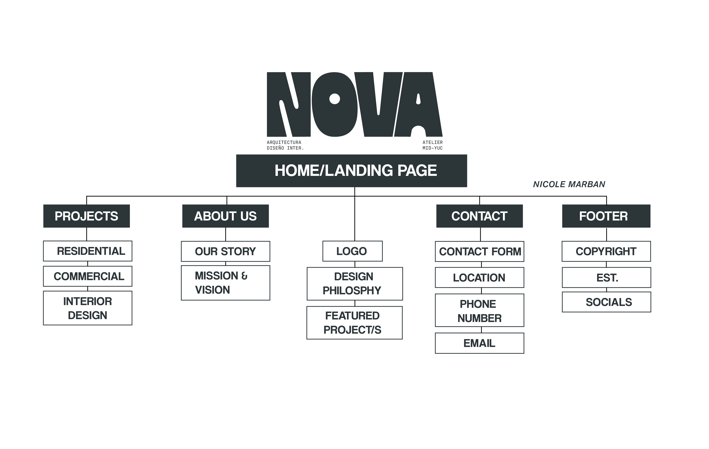
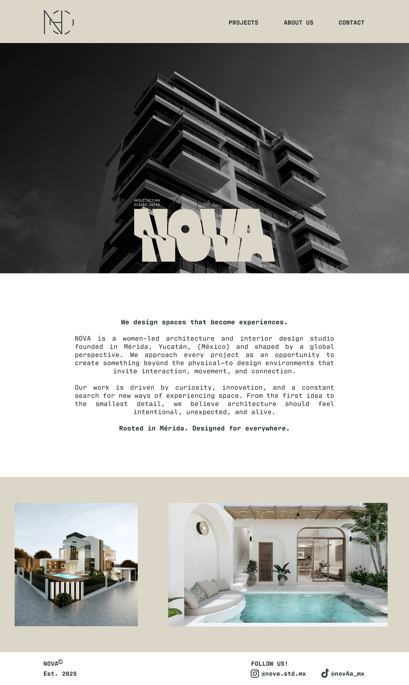
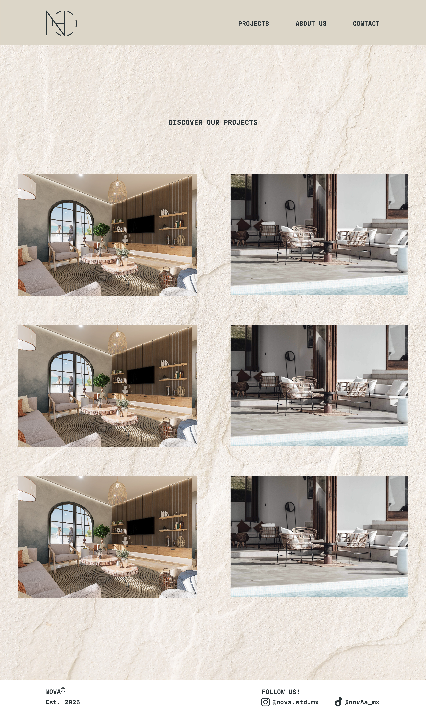

# Link to my midterm website:

https://nicmarr.github.io/MidTerm_Nova/

## the concept: 
I decided to use a personal brand identity project I created over the summer (one of several) as the basis for the website. Nova was one of the last identity brands I created in August before returning to classes for this semester, and the only design I created with the intention of it being used by architects and interior designers. I created Nova with the idea that my client was a firm of women artists, designers, and architects based in my hometown in Mexico, but who work with clients internationally. I wanted the design itself to have the same look and feel as the brand board I created, so some of the images, such as the backgrounds in the Projects and Contact sections, along with some of the mockup photos I included in the projects, are images I already had saved in my design folder. Later on, I would like to create websites for my other brand identity designs to expand my design portfolio, and then work on creating my own portfolio.

## sitemap:

## wireframes:

